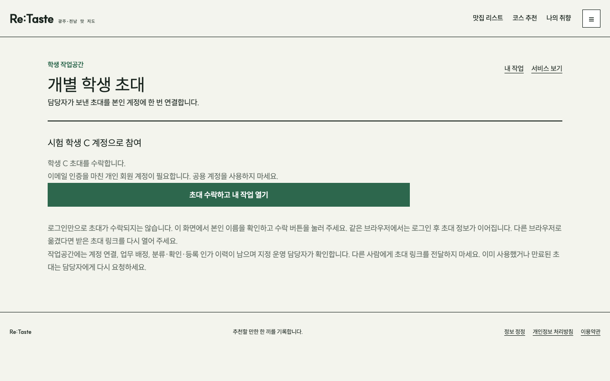
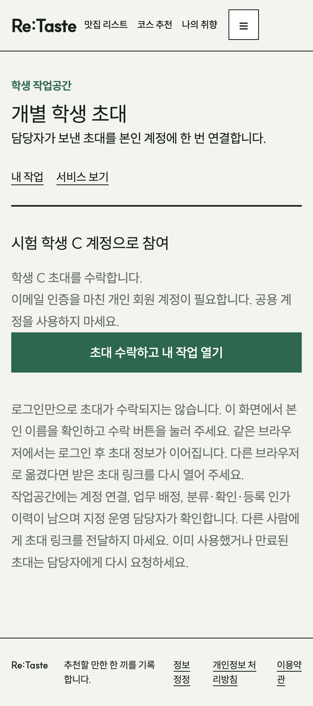

# 학생 초대의 로그인 전후 전달

상태: GO — Issue #315의 병합 PR에 명시한 범위. 담당: Jay/Codex.

## 문제와 선택

초대 링크의 fragment는 서버로 전달되지 않는다. 기존 구현은 브라우저의 탭 단위 sessionStorage에서 이를 복원했으므로 저장소가 차단되거나 다른 빈 탭에서 로그인하면 인증만 성공하고 수락 버튼이 사라졌다. #314의 수동 링크 붙여넣기는 복구 수단으로 유지한다.

로그인/가입 버튼을 서버 POST로 바꿔, 이동 전에 기존 초대를 읽기 검증하고 암호화된 임시 쿠키에 보관한다. 로그인 후 서버가 쿠키를 읽어 같은 브라우저의 다른 탭에서도 수락 화면을 그린다. 초대 정보 전달과 실제 수락은 별개다. 자동 수락이나 좌석 연결은 없다.

## 신뢰 경계와 보안 계약

- 공개 준비 POST는 동일 origin 검사, 16KiB 본문 제한, 허용된 intent와 43자 토큰 schema를 먼저 검증한다. 초대의 존재·미사용·미취소·미만료, 좌석의 미연결·활성·미만료를 D1 SELECT로 확인한다. 준비 요청은 DB에 쓰지 않는다.
- cookie는 `__Host-retaste_student_invite`(로컬 HTTP 시험만 다른 비접두 이름), host-only, Path=/, HttpOnly, SameSite=Lax, HTTPS Secure다. javascript/localStorage/URL query로 쿠키 값을 내보내지 않는다. 서버 loader에는 토큰 대신 보존 여부와 좌석 코드만 노출한다.
- 기존 jose의 `EncryptJWT`/`jwtDecrypt`와 AES-256-GCM(dir/A256GCM)을 사용한다. 고정 목적 문자열과 전용 secret으로 SHA-256 키를 유도한다. issuer·origin audience·iat·exp와 최대 1시간을 확인하고, 원래 초대 만료를 넘기지 않는다. 변조·다른 키/사이트·중복/과대 cookie는 복원하지 않는다.
- 새 전용 키 `STUDENT_INVITE_COOKIE_SECRET`은 CSPRNG 32바이트로 생성하여 지정 Worker secret에만 보관한다. 원래 문서의 SESSION_SECRET은 현재 운영 이름 목록에 없어 재사용하지 않는다. 비밀값을 출력하거나 파일로 남기지 않고 기존 인증 secret은 바꾸지 않는다.
- cookie는 로그인 세션이나 사용자 권한이 아니다. 최종 수락 POST에서 기존 인증, 이메일 확인, 일반 계정, 초대·좌석 유효성, 계정 중복, 원자 claim 검사를 다시 수행한다. 수락 성공/이미 연결된 작업공간 이동에서는 cookie를 만료시킨다.
- 준비했던 초대가 취소되거나 다른 계정에서 사용되면 최종 수락을 거부한다. browser cookie를 복사해도 원래 single-use·한 계정/좌석 불변식은 유지된다. 사용자에게 현재 계정 이름을 표시하며 cookie로 복원된 화면에는 좌석도 표시한다.
- raw token이 있는 기존 탭은 그 토큰을 우선하여 다른 탭의 cookie가 원래 링크를 덮어쓰지 않는다. 여러 초대를 같은 브라우저에서 준비했다면 cookie 기반 복원은 마지막 준비 초대이며 그 좌석을 화면에서 명시한다.

## 범위와 대안

새 테이블·migration·라이브러리·인증 공급자·외부 전송·binding·cron을 추가하지 않는다. 준비당 D1 읽기 2회와 짧은 대칭 암호 연산만 추가한다. 새 월정액 비용 없음. cookie에는 기존에 전달받은 초대와 좌석만 있고 계정 개인정보는 추가하지 않는다.

원문 토큰을 로그인 returnTo query에 넣는 방식은 로그/히스토리 노출 때문에 배제했다. localStorage는 브라우저 차단을 해결하지 못하고 javascript에 계속 노출되므로 배제했다. DB 임시 테이블과 별도 세션 서비스는 이 문제에 불필요하다. 서명만 한 원문 cookie보다 암호화 cookie를 선택했다.

브라우저 자체를 바꾸면 cookie는 공유되지 않는다. 이 경우 원래 전체 링크를 다시 열거나 #314의 수동 복원을 사용한다. 모든 cookie를 거부하면 로그인 자체가 성립하지 않으므로 이를 우회하지 않는다. 실제 학생의 Google 계정과 기기는 이번 합성 회귀를 대신하지 않는다.

## 운영 실행과 rollback

대상: 계정 7543330c65069ee2df1b7b353fb0201c, profile tastedit-production, Worker retaste-beta. 담당 Jay.

1. 기존 운영 초대5행·좌석4행·과제56행 비민감 digest와 현 Worker version을 기록한다. 원격 DB 변경은 없다.
2. `wrangler secret list --profile tastedit-production` 이름만 읽어 전용 키가 없을 때만 메모리에서 32바이트를 생성한다. `wrangler secret put STUDENT_INVITE_COOKIE_SECRET --profile tastedit-production`의 stdin으로 한 번 설정한다. 이미 존재하면 덮어쓰지 않는다. 값·token 출력/저장 없음.
3. 필수 CI 통과·diff 검토·PR 병합 후 최신 main을 build하고 `wrangler deploy --profile tastedit-production`한다. 기존 cron·권한·초대·배정은 보존한다.
4. 기존 C/D 링크를 검증용으로 수락하지 않는다. 준비 POST→기존 운영자 로그인→다른 탭에서 계정/좌석·수락 버튼 표시까지만 확인하고, cookie를 가진 관리자도 수락 권한이 없음을 로컬에서 검증한다. 이후 운영자 RSI 6경로와 보존 digest를 확인한다.
5. rollback Worker는 3063bc5c-134d-4a96-89c1-5b62056cf160이다. 이전 코드는 새 cookie를 무시하며 최대 1시간 뒤 자연 만료된다. rollback 후 새 기능을 폐기할 때만 전용 secret을 제거한다. 기존 키나 운영 데이터를 되돌리지 않는다.

## 회귀 기준

C/D × 같은 탭/저장소 차단/빈 새 탭 × Chromium/WebKit에서 로그인 후 수동 붙여넣기 없이 수락 버튼이 표시되고 명시적 수락 뒤 자기 QA 상세를 연다. 원문이 cookie 문자열에 노출되지 않고 HttpOnly/SameSite/Secure/만료가 맞아야 한다. 변조·다른 origin·만료·잘못된 키·CSRF·취소/사용된 초대·관리자 계정의 수락을 거부해야 한다. 기존 세션 만료 복구와 B 두 링크 경쟁 회귀도 유지한다.

## 화면 검증 자료

로컬 합성 C 계정, 저장소 차단 후 로그인 복귀 화면이다. 실제 계정·초대값·운영 데이터는 포함하지 않는다.

