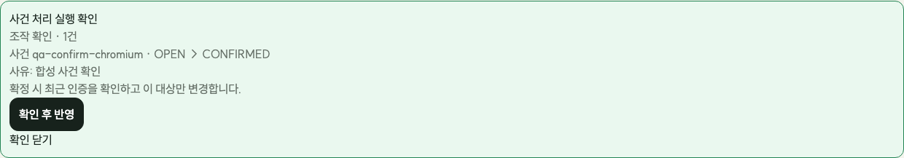
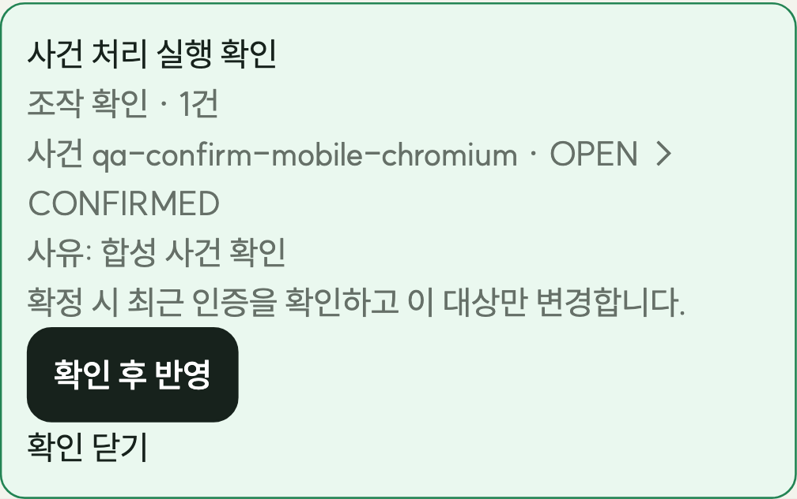

# ADMIN P0 통합 검증

검증 대상은 B01–B05 연결 및 최종 HTTP 보호다. 합성 로컬 D1/브라우저이며 실제 운영 증거와 구분한다.

- 전체 ADMIN HTML/data/302/403/500 응답을 최종 Worker에서 private/no-store, Vary: Cookie로 보호. 기존 Vary 값과 공개 페이지 캐시는 보존한다. 집중 단위3건 통과.
- 사건 처리 미리보기 → 최근인증 미충족 시 변경 없이 이동 → 실제 검증을 모델링한 로컬 인증 증거 → 변경·감사 1회 → 중복 결과 조회를 D1 route 시험1건으로 확인했다.
- 감사 쓰기 실패 시 대상 변경0과 같은 operationId 재확인 후 성공을 확인했다. 결과 불명 화면도 해당 ID/kind를 유지한다.
- desktop/mobile Playwright2건 통과. 미리보기 대상·현재/예정 상태·사유 표시, 재인증 이동 뒤 복귀주소에 동일 operationId/kind 보존, no-store와 가로 넘침 없음을 확인했다.
- 최초 browser2건 실패는 숨은 caseId를 화면 텍스트로 찾은 새 시험 locator 오류였다. 실제 DOM에는 USER subject만 표시되고 hidden input에 caseId가 있었다. 동일 대상 hidden input을 기준으로 수정했으며 제품/timeout/retry를 완화하지 않았다.

