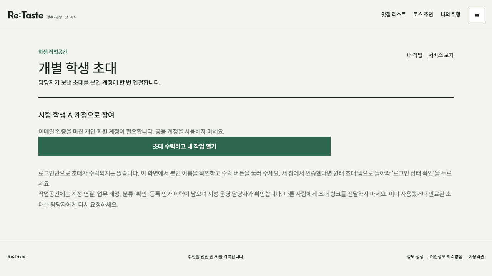
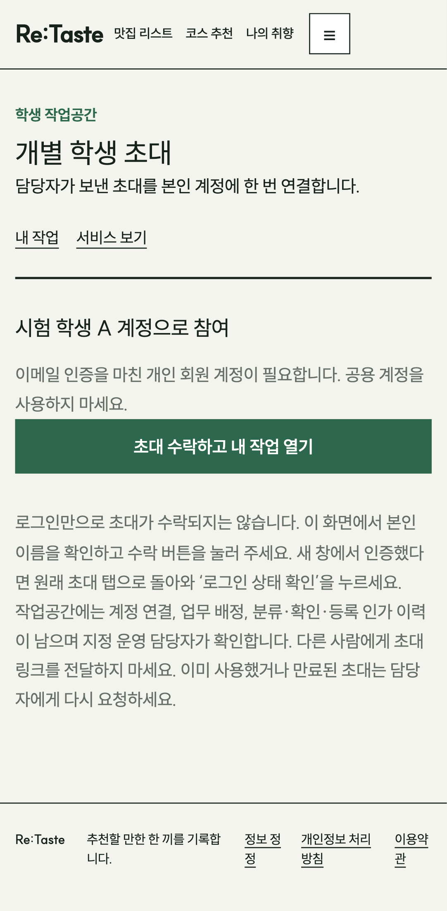

# 학생 인증 이후 초대 연결 복구

관련 이슈: #307. 담당: Jay / Codex. 기준 코드: `cf1f406c`.

## 확인된 원인

2026-10-20 10:36:32 KST에 생성된 Google OAuth 요청이 10:36:46 KST에 소비되었으며, 복귀 경로는 `/student/`였다. 같은 시각 개인 회원의 이메일 인증 상태와 유효한 로그인 세션이 생성되어 있다. 제공된 화면의 오류 시각과 일치한다. Google 로그인 실패가 아니라 **로그인 완료 이후 학생 초대가 아직 계정에 연결되지 않은 상태**다.

읽기 전용 운영 조회에서 학생 좌석 연결 0, 초대 소비 0, 중지 0, 만료 0이 확인되었다. 기존 초대 네 건과 배정 56건(A/B 각 26, C/D 각 2)은 유지되어 있다. 이름과 계정 식별자, 초대 원문, token hash, 세션 값은 이 문서에 기록하지 않는다.

기존 `/student`는 계정 인증을 통과한 뒤 좌석이 없으면 일반적인 접근 불가 403 화면을 표시했다. 이 화면은 로그인 링크만 제공하므로 이미 인증된 사용자를 복구시키지 못했다. 초대 페이지는 URL fragment를 지운 후 React 메모리에서만 토큰을 유지하여 새로고침/같은 탭 로그인 이동 시 잃었다. 이미 로그인된 `/login` 방문에서는 지정한 복귀 경로도 무시하고 홈으로 보냈다.

## 로그 확인 범위와 한계

- 운영 D1: 좌석, 초대, 과제, 사용자 이메일 인증 상태, 세션 생성/만료, OAuth 요청 생성/소비/복귀 경로, 관리자 감사 이벤트를 교차 확인했다. 읽기 조회의 rows_written은 0이다.
- Workers 과거 Observability: 공식 telemetry query API를 호출했으나 현재 운영 OAuth 자격의 scope에서 HTTP 403 `Authentication error`가 반환되었다. 과거 원문 로그 전체를 읽었다고 주장하지 않는다. 기존 head sampling은 0.1이므로 권한이 있어도 전체 요청을 재구성할 수 없다. 권한 변경이나 로그 전수 수집 설정 변경은 이 수정에 포함하지 않는다.
- 테스트: 기존 코드에서 인증된 미연결 회원의 403, 로그인 복귀 경로 무시, 모바일 초대 새로고침 시 소실을 재현했다. 개인 학생의 세션을 대행하지 않고 로컬 합성 fixture를 사용했다.

## 변경 내용과 보안 경계

1. 좌석이 아직 없는 개인 회원의 작업공간 방문은 초대 연결 안내로 이동한다. 정지/만료된 연결 좌석과 관리자 접근은 계속 거부한다.
2. 초대의 토큰을 해당 탭의 sessionStorage에 최대 1시간 보관한다. 새 fragment가 잘못되면 이전 초대로 fallback하지 않는다. 저장소 차단 시 현재 페이지의 유효한 토큰으로만 동작한다. 작업공간 진입 후 삭제한다. 영구 저장소, URL query, 로그인/OAuth 복귀 URL 및 로그에 토큰을 넣지 않는다.
3. 로그인/회원가입을 같은 탭에서 진행하고, 상호 링크와 이미 로그인된 상태에서도 검증된 내부 복귀 경로를 유지한다.
4. 계정 이름을 확인한 뒤 **초대 수락하고 내 작업 열기**를 누르는 명시적 절차는 유지한다. 관리자가 이름으로 계정을 추정하여 연결하거나 초대를 재발급하지 않는다.
5. 초대 미연결 복귀는 개인정보 없는 `STUDENT_ONBOARDING_REQUIRED`와 고정 reason만 기록한다.

## 운영 인계

학생에게는 기존 본인 초대 링크를 다시 열고 본인 계정으로 로그인한 뒤 수락 버튼을 누르도록 안내한다. 토큰 없는 `/student/join` 주소만 전달하면 초대 자체가 없으므로 연결되지 않는다. 기존 초대 원문은 지정된 비공개 개별 전달 자료를 그대로 사용한다. 다른 사람의 초대 링크 공유 금지.

배포 전 CI와 데스크톱/모바일 회귀 확인이 필요하다. 배포 담당 Jay / Codex가 병합된 main에서 `CLOUDFLARE_ACCOUNT_ID=7543330c65069ee2df1b7b353fb0201c pnpm run deploy -- --profile tastedit-production`에 해당하는 build + Wrangler 배포를 기존 Worker 대상으로 실행한다. Wrangler 옵션 전달을 위해 실제 실행은 `pnpm run build` 후 `pnpm exec wrangler deploy --profile tastedit-production`로 분리할 수 있다.

운영 DB migration/학생 데이터 수정/초대 발급/과제 재배정/외부 메일 발송/새 binding은 없다. 배포 후 기존 초대와 과제 digest를 대조하고 운영 경로의 안내 및 비인가 차단, 기존 RSI 감사 기록 또는 라이브 자검을 확인한다. rollback은 배포 직전 Worker version을 재활성화한다. 실제 학생의 수락 및 작업 성공은 별도 운영 상태이며 코드 검증과 혼동하지 않는다.

## 검증 결과

- 수정 전 회귀: 미연결 계정은 403, 이미 로그인된 계정은 복귀 경로 대신 `/` 이동, 모바일 새로고침 후 초대 UI 소실을 재현했다.
- 수정 후: 단위 153 파일 962건, Workers 통합 80 파일 409건, 학생 브라우저 시나리오 데스크톱/모바일 총 6건 통과. `pnpm run typecheck`, `pnpm run build`, `pnpm audit --prod --audit-level=high` 통과.
- 테스트는 로컬 합성 계정만 사용했으며 실제 학생 계정의 수락을 대신하지 않았다.

