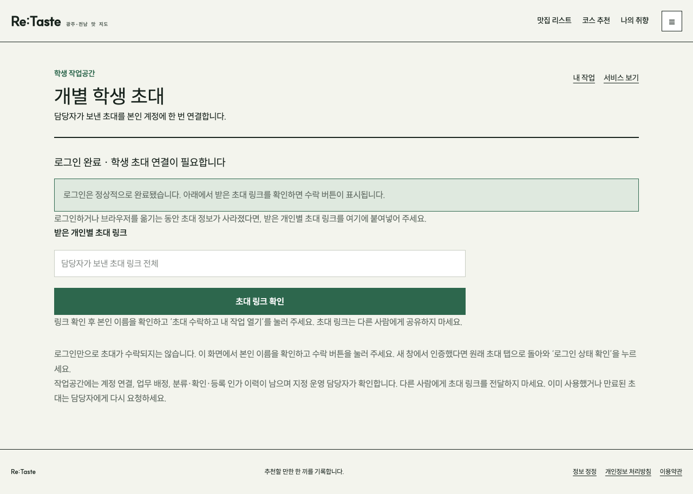
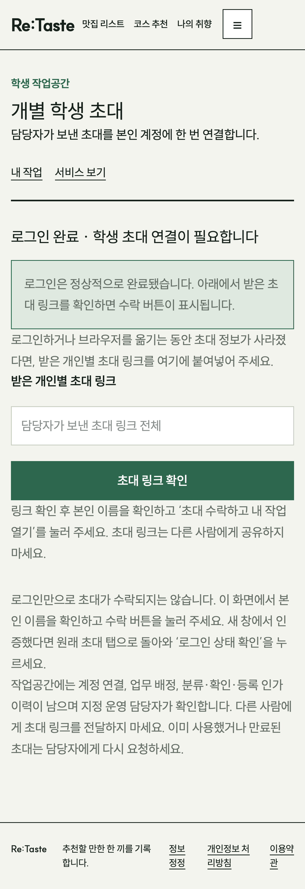
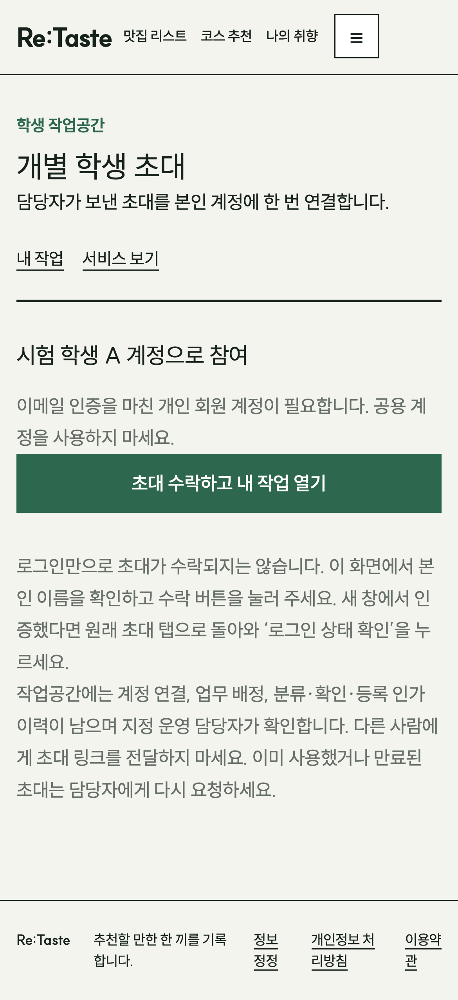

# 학생 초대 링크 복원과 기존 링크 유지

담당: Jay/Codex. Issue #313. 기존 개인별 링크로 수락을 마칠 수 있도록 로그인 후 초대 정보가 없는 화면에 복원 입력을 제공한다.

## 확인한 문제와 증거 경계

운영 제보 화면은 로그인은 완료됐으나 `/student/join`에서 초대 토큰이 없는 분기다. 이 상태에는 수락 버튼이 없다. 탭·브라우저 전환, 저장소 만료 또는 전달된 링크 일부 누락 중 무엇이 해당 학생에게 발생했는지는 화면만으로 확정하지 않는다. 이전 두 수락 요청의 정확한 실패 원인도 이 변경으로 확정되지 않는다.

사용자는 후속으로 B 좌석의 기존 링크와 새 링크를 모두 유지하도록 지시했다. 이 지시는 일반적인 재발급 정책 변경이 아니라 기존 두 링크의 명시적 보존이다.

## 학생 사용 순서

1. 로그인 완료 화면의 **받은 개인별 초대 링크**에 본인에게 받은 전체 링크를 붙여넣는다.
2. **초대 링크 확인**을 누른다.
3. 표시된 계정 이름이 본인인지 확인한다.
4. **초대 수락하고 내 작업 열기**를 누른다.

링크 확인만으로 계정을 연결하거나 권한을 부여하지 않는다. 로그인/이메일 인증/개인 계정/좌석 유효성 검사는 기존 서버 코드에서 계속 수행한다.

## 보안과 데이터 정책

- 입력은 동일 origin의 `/student/join` fragment 또는 기존 43자 토큰만 허용한다. 사용자 입력 URL로 이동하거나 fetch하지 않는다.
- 입력을 query, localStorage, 로그 또는 새 cookie에 저장하지 않는다. 복원 즉시 입력을 지우고 기존 한 시간 sessionStorage를 최선 노력으로 이용한다. 저장소가 차단된 브라우저도 현재 화면에서 수락할 수 있다.
- `0039_student_invite_aliases.sql`은 활성 초대의 좌석별 고유 인덱스를 동일 조건의 조회 인덱스로 바꾼다. 토큰 해시의 고유성, 계정당 좌석 고유성, 비어 있는 좌석의 원자적 claim은 유지한다.
- 일반 재발급은 계속 해당 좌석의 이전 미사용 링크를 모두 취소한다. 명시적으로 유지한 링크라도 한 좌석을 서로 다른 두 계정이 수락할 수 없다.
- 새 인증 공급자·패키지·테이블·binding·cron·유료 서비스는 없다. 기존 D1의 인덱스 변경과 제한된 복원 1행에 따른 소량의 읽기/쓰기만 발생한다. 개인정보 수집·전송 범위는 늘리지 않는다.

## 운영 실행 범위 (GO)

병합된 main에서 지정 계정 `7543330c65069ee2df1b7b353fb0201c`, 프로필 `tastedit-production`, Worker `retaste-beta`, D1 `retaste-production` (`5181489d-83a7-4f78-9384-db096cadaa2d`)에 실행한다.

1. 현재 Worker와 D1 Time Travel bookmark, 비민감 상태 digest를 보관한다. 원문 초대·계정·점포 자료는 출력하거나 커밋하지 않는다.
2. 원격 migration 대기를 읽어 `0039_student_invite_aliases.sql`만 대기하는지 확인하고 그 파일만 적용한다. 다른 대기가 있으면 일괄 적용하지 않는다.
3. B가 활성·미연결·미만료이고, 기존 B 초대가 생성 `2026-10-15T03:41:26.589Z`, 취소 `2026-10-20T05:56:08.863Z`, 미사용·미만료이며 새 B 초대가 생성 `2026-10-20T05:56:08.863Z`, 미취소·미사용·미만료인 조건을 SQL 안에서도 확인한다.
4. 위 조건에서 기존 B 초대의 `revoked_at`만 NULL로 변경한다(최대 1행). 이어 같은 배치에서 지정 운영자의 `STUDENT_INVITE_RESTORED` 감사 1행을 남긴다. 감사에는 B 좌석과 유지 정책 등 상수만 기록하고 링크·토큰·해시·개인정보를 넣지 않는다. 조건이 달라졌거나 업데이트 0행이면 무조건 덮어쓰지 않는다.
5. 새 B 초대, 두 링크의 토큰 해시·만료일, A/C/D, 계정, 좌석, 과제 56건을 보존한다. 수락이 동시에 발생한 경우에는 그 실제 변화를 별도로 확인한다.
6. 지정 계정 환경 변수로 `pnpm run build` 후 `pnpm exec wrangler deploy --profile tastedit-production`로 병합 main을 배포한다. 라이브 복원 UI·공개 경로·기존 운영자 RSI 6경로를 확인한다. 실제 학생 초대를 검증용으로 수락하지 않는다.
7. 기존 감시는 유지된 두 B 링크를 인지하되 수락·실제 작업 접근은 별도의 증거로 판단한다. 한 링크의 만료를 좌석 전체 접근 불가로 오인하지 않는다.

## 검증

단위 테스트는 동일 origin·올바른 경로·fragment만 복원하고 다른 origin/경로/userinfo/잘못된 토큰을 거부한다. 로컬 D1 통합 테스트는 서로 다른 두 링크의 동시 수락에 한 계정만 성공하고, 일반 재발급 시 이전 링크 모두 취소됨을 검증한다. Chromium와 모바일 WebKit에서 로그인 완료·초대 정보 없음 상태와 저장소 차단 상태 모두 링크 복원→명시적 수락→작업 목록 진입을 검증한다. UI 증거는 합성 계정이며 실 초대는 포함하지 않는다.

## 롤백

Worker는 직전 `097c603c-56fb-4cac-95ca-d73ba0cda93e`로 복원한다. B 복원 취소가 필요한 경우 해당 초대가 여전히 미사용이고 B가 미연결이며 이후 관리 변경이 없을 때만 기존 취소 시각으로 되돌린다. 이미 학생이 수락했다면 좌석이나 계정을 자동으로 되돌리지 않는다. 인덱스는 이전 Worker와 호환되므로 파괴적 역 migration하지 않는다. 고유 인덱스 복구가 필요하면 활성 중복 정리의 별도 승인을 포함한 전진 migration으로 처리한다.

## 합성 화면 증거

로컬 검증: 단위 974개, D1 통합 427개, Chromium/WebKit 브라우저 8개 통과. 타입 검사·빌드 통과, 운영 의존성 audit 취약점 없음. WebKit의 기존 관리자 fixture 날짜 표기 hydration 경고는 별도로 남으며 학생 복원·수락 흐름은 통과했다.
