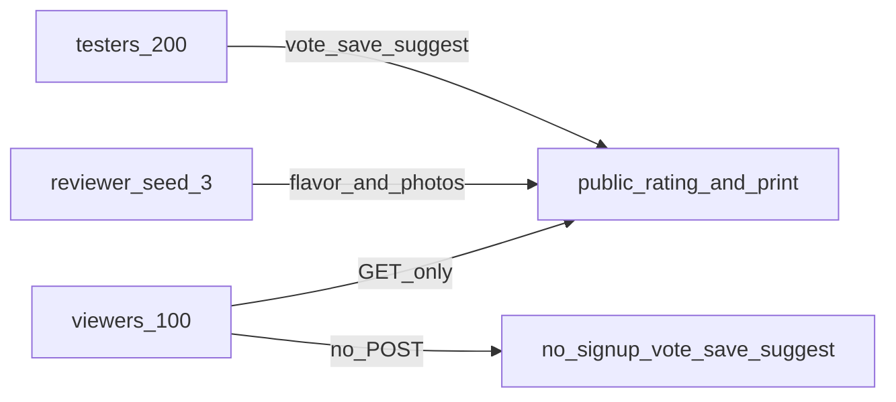

# 2026-08-18 격리 합성 베타 200 테스터 + 100 뷰어

> **상태:** `PROPOSED` — 격리 하드테스트 계획이다. 라이브 200 가입, 카탈로그 일괄 공개, 공개 베타 GO, `k6`, Queue, 새 D1/binding을 승인하지 않는다.

**Goal:** 라이브와 같은 한도·공개 장소 2곳을 격리 D1에 복제하고, 베타테스터 200명(쓰기)과 뷰어 100명(읽기·관찰만)으로 하드테스트한다. 회원 간 직접 채팅은 없고, 투표·리뷰어 평가가 공개 점수·Flavor Print·추천에 반영되는 간접 소통만 검증한다.

**추적:** [#206](https://github.com/taejunyun1/Tasted_it/issues/206)

**거버넌스:** [`docs/decisions/2026-08-10-tech-stack-governance.md`](../../decisions/2026-08-10-tech-stack-governance.md) — 상태 `PROPOSED`. 이 문서는 스택 예외가 아니다. 새 테스트 프레임워크(`k6`)와 새 Cloudflare binding은 넣지 않는다.

**코드 기준선:** `origin/main` `32c52cf`

**담당:** Jay (`deximple`)

**선행 제약:** [`2026-08-07-product-ready-stage-1-100-300-ccu.md`](./2026-08-07-product-ready-stage-1-100-300-ccu.md)는 `PROPOSED / HOLD`다. 이 문서는 그 Stage 1 300 CCU/`k6` 계획을 실행하지 않는다.

---

## 0. 결정 (이미 고정)

| 항목 | 값 |
|---|---|
| 규모 | 베타테스터 **200** + 뷰어 **100**. 동시 CCU 200이 아니다. |
| 환경 | 격리 로컬/preview D1만. 라이브 Worker·`retaste-production`·라이브 NAVER·Resend 쓰기 없음. |
| 한도 복제 | 메일 가입 IP 시간당 10, 로그인 IP 15분당 20, NAVER 일일 20,000(스텁), 공개 장소 **2곳**. |
| 테스트 도구 | 기존 Vitest workers + `fetch` 스크립트 + Playwright 소수(테스터 5, 뷰어 3). `k6` 없음. |
| 격리 설정 | [`wrangler.e2e.jsonc`](../../../wrangler.e2e.jsonc) placeholder D1 id. `--local --persist-to`만. 운영 `database_id` 재사용 금지. |

이 문서의 `PROPOSED` 병합은 격리 하네스와 문서 채택이다. 라이브 가입·일괄 공개·공개 베타·유료 API·원격 D1 쓰기를 승인하지 않는다.

## 1. 제품에 있는 “소통” (없는 것부터)

직접 DM, 댓글, 팔로우, 멘션은 **없다**. 회원끼리 말하는 경로는 공개 파생물뿐이다.

- 회원 투표 → 장소 상세 추천율/스냅샷. 뷰어가 숫자 변화를 본다.
- 리뷰어 Flavor 평가 3건 이상 → Flavor Print `VISIBLE`. 뷰어가 상세에서 본다.
- 리뷰어 사진·Golden Pick·공개 프로필 [`/reviewers/:slug`](../../../app/routes/reviewer-profile.tsx).
- 투표 이후 홈/개인 추천 믹스가 바뀜 ([`app/routes/home-recommendations-resource.tsx`](../../../app/routes/home-recommendations-resource.tsx)).
- 리뷰어는 제출 전 타인 개별 선택을 보면 안 된다. 테스터 코호트에서 교차 조회를 금지하고 검증한다.
- 제안·정정은 회원↔관리자이지 회원↔회원이 아니다.

카탈로그가 2곳이면 회원 취향 그래프(`getMemberTasteGraph`, 공개 Flavor Print 장소 5곳 필요)는 `LEARNING`에 머문다. 이를 실패가 아니라 **희소 카탈로그 관측**으로 기록한다.

## 2. 역할



- **테스터 200**: 시드된 인증 계정으로 여정을 수행한다. HTTP 가입 200건은 한 IP에서 불가능하므로 D1에 사전 시드하고, 가입 폭주는 별도 abuse 웨이브로만 돌린다.
- **뷰어 100**: 로그인·가입·투표·저장·제안·온보딩 완료/스킵 없음. 공개 GET만. 테스터 웨이브와 **겹쳐서** 돌려 점수/프린트/추천이 바뀌는 것을 관찰 로그에 남긴다. 홈 게스트 쿠키가 생겨도 POST는 하지 않는다.
- **리뷰어 시드 3**: 테스터 200 밖. 두 공개 장소에 Flavor 3건을 미리 채워 뷰어가 `VISIBLE`을 보게 한다. 하드테스트 중 추가 리뷰어 대량 신청은 하지 않는다 (승인 제안 10곳 게이트).

## 3. 테스터 200 믹스

- **guest_read 120**: 비로그인 홈·`/places`·상세 2곳. 쓰기 없음. 뷰어와 겹치지 않게 ID만 구분 (게스트 테스터는 관찰 로그를 남기지 않음).
- **member_vote 50**: 두 장소에 추천/비추천/철회/저장. 한 `(userId, placeId)` 현재 투표 1개 불변식.
- **member_suggest 16**: 광주전남 접수, 범위 밖 400, 중복 시 사유 필수. `SUBMITTED`만. 일괄 공개 없음.
- **member_edge 10**: 미인증 제안 차단(삽입 0), 탈퇴 익명화, 14세 미확인 400, 리뷰어 평가 교차 조회 거부(403).
- **abuse 4 시퀀스**: 동일 IP 가입 11번째·로그인 21번째가 429인지. 성공 조건이다.

시드 계정은 `synth+NNN@example.test`, 이메일 사전 인증 80명(`001`–`080`). 뷰어는 계정 없음. 합성 IP는 테스터마다 다르게 주고, abuse만 IP를 공유한다.

## 4. 뷰어 100 — 작동·관찰

허용 GET: `/`, `/places`, `/places/:slug`, `/maps/:categorySlug`, `/reviewers/:slug`, `/resources/home-recommendations`, `/privacy`, `/terms`.

금지: signup/login/logout, vote/save, `/suggestions/new`, `/corrections/new`, `/onboarding/taste` 완료·스킵, `/reviewer/apply`, `/me`, admin.

관찰 로그(장소 상호·PII 없음):

- 웨이브 전후 두 장소의 추천 표본 수·추천율 구간 (테스터 투표가 보이는지)
- Flavor Print `LEARNING` vs `VISIBLE`와 `ratingCount`
- 홈 추천 슬롯 개수·빈 상태 (2곳 희소 카탈로그)
- 5xx = 0에 가깝고, 뷰어 경로 4xx는 404 외 없어야 함
- 뷰어 세션에서 `current_votes` / `place_suggestions` insert 0

뷰어 100이 테스터와 같은 공개 장소를 동시에 읽으므로, 희소 카탈로그 + 투표 재계산의 읽기 경합이 이 플랜의 하드 포인트다.

## 5. 픽스처

- 합성 상호 2곳. **라이브 상호 복사 금지.**
- 카테고리 시드(부모+자식). Flavor 템플릿 1개 ACTIVE.
- admin 1, 리뷰어 3 + 장소당 Flavor 3건 → Print `VISIBLE`.
- 테스터 80 인증 계정과 세션. 뷰어 계정 없음.
- persist-to는 `.wrangler/synthetic-beta-state` (gitignore). run 후 폐기. 푸시 금지.

## 6. 실행 방법

1. 문서 PR: 이 파일 `PROPOSED`. Issue `#206` + `jay_synthetic_beta_200_plan`.
2. 격리 하네스: Vitest workers(불변식·200/100 웨이브) + `scripts/run-synthetic-beta-200.mjs`(HTTP fetch) + Playwright 소수(테스터 5, 뷰어 3, `SYNTHETIC_BETA=1`).
3. 리포트: `#206` 댓글. 상호·이메일 원문·좌표 미기록. 격리 DB는 run 후 폐기.

### 로컬 how-to (격리만)

```bash
export PATH="/Users/jaysong/.local/bin:$PATH"
rm -rf .wrangler/synthetic-beta-state
pnpm exec wrangler d1 migrations apply DB --local --config wrangler.e2e.jsonc --persist-to .wrangler/synthetic-beta-state
pnpm exec wrangler d1 execute DB --local --config wrangler.e2e.jsonc --persist-to .wrangler/synthetic-beta-state --file scripts/seed-synthetic-beta-200.sql
# Vitest workers (CI와 동일 경로)
pnpm exec vitest run --config vitest.workers.config.ts tests/integration/synthetic-beta-200.test.ts
# HTTP fetch: 별도 persist로 개발 서버를 띄운 뒤
# RETASTE_E2E=true CLOUDFLARE_VITE_WRANGLER_CONFIG_PATH=wrangler.e2e.jsonc pnpm dev --host 127.0.0.1
# SYNTHETIC_BETA_BASE_URL=http://127.0.0.1:5173 node scripts/run-synthetic-beta-200.mjs
# Playwright 소수(테스터 5, 뷰어 3): SYNTHETIC_BETA=1 pnpm exec playwright test --config playwright.synthetic-beta.config.ts
rm -rf .wrangler/synthetic-beta-state
```

라이브 URL·운영 D1·`--remote`는 쓰지 않는다.

## 7. 성공 / 중단

**성공:** 테스터 불변식 유지, 뷰어 mutation 0, abuse 429, 투표 후 뷰어가 점수 변화 관측, Flavor Print 관측, 5xx ≤ 0.5%, 라이브 무변경.

**중단:** 라이브 URL/계정 등장, 일괄 공개, 실제 NAVER/Resend, 뷰어 POST, PII 로그, D1 30초 쿼리.

## 8. 하지 않는 것

라이브 200 가입, 카탈로그 일괄 공개, 공개 베타 GO, `k6`/Queue/새 D1, 뷰어를 숨은 테스터로 쓰기, 라이브 상호 복사, 새 Cloudflare binding.

## 9. 승인과 rollback

이 PR 병합은 `PROPOSED` 문서와 격리 하네스 채택이다. 라이브 배포·원격 apply·NAVER/Resend 실호출은 범위 밖이다. Rollback은 이 문서와 하네스 파일 revert. 격리 persist 디렉터리는 커밋하지 않으므로 삭제하면 된다.

---

# 2026-08-18 Isolated synthetic beta: 200 testers + 100 viewers

> **Status:** `PROPOSED` — isolated hard-test plan. Does not approve live 200 signups, mass catalog publish, public-beta GO, `k6`, Queues, or a new D1/binding.

**Goal:** Copy live-like limits and two published places onto an isolated D1, then hard-test with 200 beta testers (writes) and 100 viewers (GET/observe only). There is no member-to-member chat. Only indirect communication is in scope: votes and reviewer ratings that surface as public scores, Flavor Print, and recommendations.

**Tracking:** [#206](https://github.com/taejunyun1/Tasted_it/issues/206)

**Governance:** [`docs/decisions/2026-08-10-tech-stack-governance.md`](../../decisions/2026-08-10-tech-stack-governance.md) remains `PROPOSED`. This document is not a stack exception. No new test framework (`k6`) and no new Cloudflare binding.

**Baseline:** `origin/main` `32c52cf`

**Owner:** Jay (`deximple`)

**Constraint:** [`2026-08-07-product-ready-stage-1-100-300-ccu.md`](./2026-08-07-product-ready-stage-1-100-300-ccu.md) stays `PROPOSED / HOLD`. This document does not execute that Stage 1 300 CCU/`k6` plan.

## Decisions (already fixed)

- Scale: **200 testers + 100 viewers**. Not 200 concurrent CCU.
- Environment: isolated local/preview D1 only. No live Worker, `retaste-production`, live NAVER, or Resend writes.
- Limits copied: signup 10/IP/hour, login 20/IP/15 min, NAVER 20,000/day (stub), **two** published places.
- Tools: existing Vitest workers + fetch script + a few Playwright cases (5 testers, 3 viewers). No `k6`.
- Isolation: [`wrangler.e2e.jsonc`](../../../wrangler.e2e.jsonc) placeholder D1 id, `--local --persist-to` only.

Merging this `PROPOSED` plan adopts the isolated harness and documentation. It does not approve live signup, mass publish, public beta, paid APIs, or remote D1 writes.

## Communication that exists (and does not)

There is no DM, comment, follow, or mention. Members only “talk” through public derivatives: votes → public rating; ≥3 reviewer flavor ratings → Flavor Print `VISIBLE`; reviewer photos/Golden Pick/public profile; home/personal recommendation mix. Suggestions/corrections are member↔admin, not member↔member. Reviewers must not see another reviewer’s individual unpublished choices.

With only two published places, `getMemberTasteGraph` stays `LEARNING` (needs five Flavor Print places). Record that as a **sparse-catalog observation**, not a failure.

## Roles

- **200 testers:** seeded verified accounts. HTTP signup of 200 from one IP is impossible, so accounts are pre-seeded; signup floods are a separate abuse wave.
- **100 viewers:** no login/signup/vote/save/suggest/onboarding complete-or-skip. Public GET only, overlapping tester waves. Guest home cookies may appear; still no POST.
- **3 seeded reviewers** (outside the 200): pre-fill Flavor ratings so viewers see `VISIBLE`. No mass reviewer applications during the run.

## Tester mix (200)

- guest_read 120: logged-out home / `/places` / two details. No writes.
- member_vote 50: recommend/unrecommend/withdraw/save on both places. One current vote per `(userId, placeId)`.
- member_suggest 16: in-region submit, out-of-scope 400, duplicate reason required. `SUBMITTED` only. No mass publish.
- member_edge 10: unauthenticated suggest blocked (insert 0), withdraw anonymization, under-14 signup 400, reviewer rating cross-read 403.
- abuse 4 sequences: 11th signup and 21st login from a shared IP must be 429.

Seed: `synth+NNN@example.test`, 80 pre-verified accounts (`001`–`080`). Viewers have no accounts. Unique synthetic IPs per tester; shared IP only for the abuse wave.

## Viewers (100)

Allowed GET: `/`, `/places`, `/places/:slug`, `/maps/:categorySlug`, `/reviewers/:slug`, `/resources/home-recommendations`, `/privacy`, `/terms`.

Forbidden: signup/login/logout, vote/save, `/suggestions/new`, `/corrections/new`, onboarding complete/skip, `/reviewer/apply`, `/me`, admin.

Observe (no shop names/PII): sample counts and score bands before/after votes; Flavor Print `LEARNING` vs `VISIBLE` and `ratingCount`; home slot counts / empty sparse catalog; 5xx ≤ 0.5%; viewer 4xx only 404; viewer-session inserts into `current_votes` / `place_suggestions` = 0.

## Fixture and how-to

Two synthetic published places (do **not** copy live shop names), categories, one admin, three reviewers + flavor template, 80 tester sessions. Persist-to `.wrangler/synthetic-beta-state` (gitignored); discard after the run; do not push.

Vitest workers cover invariants and the 200/100 mix. The fetch script hits an isolated `pnpm dev` (`wrangler.e2e.jsonc`). Playwright (5 testers, 3 viewers) runs only with `SYNTHETIC_BETA=1` so default `pnpm test:e2e` is unchanged.

## Success / stop / out of scope

**Success:** tester invariants hold, viewer mutations 0, abuse 429, viewers observe a score change and Flavor Print, 5xx ≤ 0.5%, live unchanged.

**Stop:** live URL/account appears, mass publish, real NAVER/Resend, viewer POST, PII in logs, D1 30s query.

**Out of scope:** live 200 signups, mass publish, public-beta GO, `k6`/Queue/new D1, using viewers as hidden testers, copying live shop names, new Cloudflare bindings.

## Approval and rollback

Merge adopts this `PROPOSED` document and the isolated harness. Live deploy, remote apply, and NAVER/Resend calls are out of scope. Rollback is revert of these files. Delete the persist directory; it is not committed.
