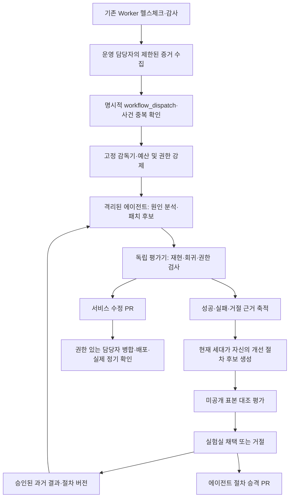

# 제한된 RSI 구현과 자기개선 효과 검증 계획

- 상태: PROPOSED / R1–R6 구현 HOLD
- 담당: Jay/Codex. 단계별 구현 담당·독립 평가 담당·배포 담당은 각 PR에 지정한다.
- 추적: [Issue #304](https://github.com/taejunyun1/Tasted_it/issues/304)
- 결정: [에이전트 절차 수준 RSI](../../decisions/2026-10-15-rsi-agent-improvement.md)
- 기준: `origin/main@cf1f406`, Node 22·pnpm 10.34.5·기존 Vitest/Workers pool/Playwright·필수 CI 네 잡
- 이번 결과물: 계획·결정·기존 문서 안내만. 구현·실험·배포 완료를 뜻하지 않는다.

## 1. 완료하려는 동작

운영 실패를 감지하면 에이전트가 근거로 원인을 좁히고 격리된 복제본에서 수정·검증한다. 성공과 거절의 이유를 다음 실행에서 조회하고, 그 이력을 이용해 **에이전트 자신의 진단·수정 알고리즘 후보**를 만든다. 고정된 외부 평가에서 이전 세대보다 효과가 확인된 후보만 다음 세대의 복구·자기개선에 사용한다.

| 수준 | 실제 동작 | 완료 주장 |
| --- | --- | --- |
| H0 현재 | 고정 6경로 HTTP 계약 검사·감사·실패 전달 | 정기 헬스체크 |
| H1 R1–R3 이후 | 증거→원인 가설→패치→재현/회귀 검증→이력 | 에이전트 장애 복구 |
| H2 R4 이후 | 결과 이력으로 개선 주체의 코드를 변경하고 다음 실행에 사용 | 제한된 자기개선 루프 구현 |
| H3 R5 이후 | 고정 모델·예산의 대조 시험, 새 사건에서 세대 간 개선 입증 | 해당 과제 범위의 에이전트 절차 수준 RSI 효과 확인 |

H2 구현과 H3 효과를 구분한다. 기반 모델 재학습·무제한 재귀·일반 지능 향상은 목표에 포함하지 않는다. 실제 학생 참여, 업로드 AI 검사와 공개 베타 GO는 [#297](https://github.com/taejunyun1/Tasted_it/issues/297), [#290](https://github.com/taejunyun1/Tasted_it/issues/290)의 별도 범위다.

## 2. 현재 코드와 재사용할 증거

- `app/features/operations/rsi-self-check.ts`: 고정 6경로 GET·상태/리디렉션 계약. 변경 없는 관측 입력으로 재사용한다.
- `rsi-self-check.server.ts`: `rsi-scheduled`/`rsi-admin` 감사·실패 전달. 두 trigger와 actor를 합치지 않는다.
- `tests/unit/rsi-native-fetch.test.ts`: 일반 JS mock이 놓친 실제 workerd 수신 객체 오류의 회귀. 외부 통신 없는 native 재현을 평가 사례의 출발점으로 삼는다.
- `tests/integration/rsi-scheduled-audit.test.ts`, `admin-rsi-check.test.ts`: 감사·인증·실패 전파 불변식.
- `.github/workflows/ci.yml`: 기존 네 잡과 고정된 Actions SHA, 최소 권한을 유지한다.

2026-10-15 15:47 정기 실패→#302·#303 수정→21:47 정기 성공은 [#297 실제 기록](https://github.com/taejunyun1/Tasted_it/issues/297#issuecomment-6192581799)이다. 이미 정답을 아는 이 사건은 개발·회귀 집합에만 넣는다. 미래의 비공개 평가 표본으로 재사용하지 않는다. 원문 운영 로그·호스트·자격증명·학생 자료를 fixture로 복사하지 않는다.

## 3. 실행 구조와 신뢰 경계

1. **관측/수집 경계:** 초기에는 운영 담당자가 기존 D1 감사의 제한된 읽기 쿼리로 자료를 수집한다. 원문 SQL·DB 권한을 에이전트에 전달하지 않는다. 수집 자동화는 R6의 별도 한정 GO가 있을 때만 설계·실행한다. 기존 두 cron은 유지한다.
2. **고정 감독기:** 신뢰된 main의 고정 SHA에서 실행한다. 사건 schema, 허용 파일·명령, 예산, 동시 실행, 검증·승격을 강제한다. 후보가 수정하는 저장소와 분리하며 검사 실패 시 실행하지 않는다.
3. **모델 broker:** 고정 provider/model·최대 입력·출력·호출 수만 제공한다. 공급자 token은 broker만 보유한다. 후보에는 임의 URL fetch·shell·cloud·DB·GitHub API를 제공하지 않는다. 모델 응답은 검증된 JSON 행동/패치 후보일 뿐이며 실행 권한이 아니다.
4. **후보 실행기:** 일회성 sandbox, 비특권 사용자, read-only 기반 이미지/의존성, 제한된 임시 workspace, 프로세스·메모리·시간 한도, 기본 외부 통신 차단. host 홈·Wrangler profile·브라우저·Docker socket·클라우드 자격증명을 mount하지 않는다. broker의 고정 IPC만 허용한다. 이 격리를 증명하기 전 실모델/운영 연결은 HOLD다.
5. **평가기:** 별도 신뢰 경계에서 정답·숨긴 사례·허용 규칙을 보유한다. 후보의 출력·종료 코드·“PASS” 문자열을 평가 근거로 신뢰하지 않는다. 외부 관측/고정 oracle과 실제 workerd·로컬 D1 결과로 판정한다. 감독기·평가기·숨긴 답안은 후보 workspace에서 읽거나 쓸 수 없다.
6. **PR/배포 경계:** 후보 실행이 끝난 뒤 별도 신뢰된 단계가 검증된 diff·보고서만 받아 PR 초안을 작성한다. 초기 R6의 실제 push/PR 출판은 운영자의 기존 `gh` 인증 문맥에서 고정 publisher로 수행한다. 자격증명이 없는 경우 PR_READY에서 BLOCKED로 멈추며 새 PAT/App을 자동 발급하지 않는다. 쓰기 token이 있는 단계는 후보 코드를 checkout/실행하지 않는다. 기존 CI·사람 병합·지정 배포 담당 원칙을 유지한다.

기본 `GITHUB_TOKEN`으로 생성한 이벤트는 후속 workflow를 자동 실행하지 않을 수 있으므로 그것을 기존 필수 CI가 시작됐다는 증거로 쓰지 않는다. 초기 운영자 출판 후 실제 PR head SHA의 네 필수 CI 실행을 조회한다. 무인 출판을 위한 GitHub App·별도 credential은 별도 후속 제안이며 현재 계획의 필수 구성이 아니다. [공식 트리거 제약](https://docs.github.com/en/actions/how-tos/write-workflows/choose-when-workflows-run/trigger-a-workflow)

GitHub-hosted runner만 사용한다고 sandbox가 성립하지 않는다. `pull_request_target`로 후보 head를 실행하거나 `workflow_run` artifact를 신뢰된 코드로 실행하지 않는다. `persist-credentials: false`, 고정 Actions SHA, job별 최소 `permissions`, 독립 cache/workspace를 사용한다. 앱 설치·테스트 스크립트도 자격증명 없는 경계에서만 실행한다. [공식 보안 근거](https://docs.github.com/en/actions/reference/security/secure-use)

## 4. 한 사건의 실행 계약

상태는 `OBSERVED → TRIAGED → REPRODUCED → PATCHED → VERIFIED → PR_READY → MERGED → LIVE_VERIFIED`다. 각 단계는 `REJECTED`, `BLOCKED`, `INCONCLUSIVE`로 끝날 수 있다. 코드·배포가 필요 없는 정상/외부 장애 사건은 `NO_CHANGE`로 닫는다. 예정된 실행이나 CI 성공만으로 `LIVE_VERIFIED`로 올리지 않는다.

| 단계 | 입력·처리 | 다음 단계로 넘어갈 증거 |
| --- | --- | --- |
| 관측 | schema에 맞는 감사 결과·source SHA·Worker version·UTC/KST·관측 창 | 지정 대상과 6경로·trigger·actor 구분, 증거 digest, 중복 여부 |
| 원인 분석 | 코드 회귀·미배포/설정·런타임 차이·외부 장애를 구분. 최소 두 가설의 지지/반증 근거 또는 UNKNOWN | 파일/실행 증거 ID, 반례, 선택한 재현 방법. 자연어 자신감만으로 확정 금지 |
| 재현 | 실제 native 조건과 합성 DB/공급자 fixture로 기준 버전 실패 확인 | 원래 조건에서 RED. 재현 실패면 패치를 계속 만들지 않고 INCONCLUSIVE |
| 수정 | 한 근본 원인, 한정 경로의 최소 diff. 앱 수정과 agent 절차 수정을 별개 candidate로 관리 | diff/hash·허용 경로 검사·사전/사후 입력 일치 |
| 검증 | RED→GREEN, 관련 회귀·권한·기존 네 CI. 비용/입력 한도도 외부 검사 | 단언·점검·감사·인가를 약화하지 않은 실제 성공. 해당하지 않는 시험은 이유와 함께 제외 |
| 기록 | 실패 가설·채택/거절 패치·검증·비용·중단 이유까지 기록 | outcome과 증거 연결. 실패를 삭제하거나 PASS로 바꾸지 않음 |
| 다음 실행 | 검증된 기록만 조회해 적용/미적용 이유를 기록 | 조회한 기록 ID·policy hash·실제 선택 행동·이전 실행과의 연결 |

incidentKey는 source/배포 버전·고정 오류 분류·실패 경로 집합으로 만들고, 관측 창과 trigger/event ID는 개별 observation fingerprint에만 넣는다. run ID와 시도 번호를 별도로 둔다. 같은 incidentKey의 연속 cron 실패는 기존 사건에 관측만 추가하며 열린 실행/PR 하나만 허용한다. 관측 시간이 달라졌다는 이유로 새 수정이나 자기개선 캠페인을 시작하지 않는다. 회복 확인/운영자 종료 후의 재발은 새 incidentEpoch와 부모 사건 ID로 연결한다. GitHub concurrency와 이력의 상태 전이를 함께 검사한다. 취소/중단 시 그 시도는 실패 이력으로 남기며 새 시도는 budget·parent ID를 새로 확인한다. 상태가 애매하면 자동 재실행하지 않는다.

## 5. 결과 축적과 자기 수정

### 5.1 기록 계약

초기 저장은 새 운영 DB 대신 비공개 CI artifact(JSON/JSONL)와 Git 버전으로 나눈다. artifact는 중간 원시 trace를 최대30일 보존한다. 다음 세대가 의존하는 승인된 익명 기록·policy·평가 요약은 PR 검토 후 Git에 남겨 artifact 만료로 학습 근거가 사라지지 않게 한다. 개인정보가 남으면 격리하고 익명화 전 사용하지 않는다.

| 필드 묶음 | 필수 내용 |
| --- | --- |
| 신원/계보 | schemaVersion, runId, parentRunId, eventFingerprint, baseAppSha, parentAgentHash, candidateAgentHash, controller/evaluator hash |
| 관측/가설 | source·trigger·UTC/KST, sanitizedEvidenceIds/digests, hypotheses와 반증, reproductionId |
| 수정/검증 | allowedDiffHash, before/after app SHA, 고정 test command IDs, RED/GREEN, regressions, verdict와 reasonCodes |
| 학습 입력 | memorySnapshotHash, retrievedLessonIds, 사용/거절 이유, 실제 tool/action trace, policy diff와 가설 |
| 평가/비용 | model ID/config, dataset/split·oracle hash, token/request/시간/금액·재시도, case별 결과와 artifact digest |
| 채택/복원 | ACCEPTED/REJECTED/INCONCLUSIVE, 결정 근거·승인 PR·활성 세대 hash·직전 검증 세대 |

원문 요청/HTML/리디렉션·쿠키·메일·초대·토큰·상호·리뷰/사진은 기록하지 않는다. 진단용 stack은 파일 위치·고정 오류 코드만 추출한다. 출력에 의심 값이 있으면 artifact 업로드/모델 전송 전에 fail closed한다. 감사 row ID와 source digest는 대조용 식별자이며 개인정보를 가져오는 권한이 아니다.

### 5.2 중복·비용 상태의 지속성과 원자성

R1/T2는 실제 호출 전에 사용할 비용 원장의 계약도 구현한다. 저장 제안은 기존 비공개 저장소의 별도 운영 데이터 ref `rsi-ledger`다. main/feature의 코드와 분리하며, 신뢰된 단일 writer만 승인된 사건·예약액·실사용·재시도·상태 JSON을 기록한다. 최초 ref 준비와 writer 권한은 R5 실모델 실험 PR의 한정 GO가 필요하다. R1–R4에서는 동일 계약을 로컬 합성 원장으로 검증한다. 이 데이터 ref의 직접 갱신은 운영 원장에만 한정된 거버넌스 예외 제안이며, 코드의 feature PR 규칙을 우회하는 통로로 쓰지 않는다.

읽은 parent SHA에서 예약 commit을 만들고 **비강제 fast-forward ref 갱신**이 성공한 경우에만 비용 호출을 허용한다. 같은 parent의 경합은 갱신 실패로 처리하고 재조회·재판정한다. 생성된 실행 intent/runId·일/월 누적액과 최대 예상 호출비를 함께 예약한다. 시각은 감독기의 UTC로 기록하고 일/월 예산 구간은 Asia/Seoul로 고정한다. 취소·runner 재시작·artifact 만료·새 workflow ID가 누적값을 초기화하지 못한다. 중복 runId는 기존 예약/결과를 돌려주며 재호출하지 않는다. 원장 접근 실패·기준 SHA 불일치·usage 미확인은 fail closed다.

실제 provider usage와 신뢰된 호출 영수증이 확인될 때만 예약을 정산한다. 응답 유실·시간초과·강제 취소는 최대 예약 비용을 소비한 것으로 남겨 과소 계산을 막는다. provider response의 모델 생성 텍스트와 usage 필드를 혼동하지 않는다. 후보의 토큰 보고를 신뢰하지 않고 broker가 요청 전 입력 토큰의 보수적 상한과 최대 출력을 계산한다. Git 원장에는 개인정보·source/trace 원문·자격증명을 넣지 않는다. R5 실모델 GO 전에는 동일 인터페이스의 로컬 합성 원장/fake만 사용한다. R5의 실모델 호출은 원격 원장 예약이 가능한 신뢰된 감독기에서만 허용한다.

### 5.3 다음 개선에 반영하는 방식

1. 고정된 조회기가 동일 오류 분류·런타임·조건으로 승인 lesson 최대5개를 선택한다. 원문 모델 출력·새 이슈 댓글은 학습 기록으로 바로 승격하지 않는다.
2. 현재 세대는 성공뿐 아니라 실패 가설·거절 패치·비용 낭비를 분석해 자신의 `diagnostic-policy.ts`/`repair-policy.ts` 변경 가설과 diff를 낸다. 예: “mock 성공 시 native probe를 생략”하던 알고리즘을 native 조건 확인이 선행하도록 변경한다.
3. 에이전트 코드 변경 가능 영역은 `scripts/rsi/agent/`의 승인된 순수 전략 모듈과 schema에 맞는 policy뿐이다. 고정 입출력은 증거 선택·진단 행동·패치 탐색·관련 회귀 선택이다. 동일한 활성 전략은 `taskKind=repair`와 `taskKind=improve-agent`를 받아 서비스 수정과 자신의 전략 모듈 수정을 모두 수행한다. `self-improve.ts`는 입력 전달·예약·승격을 강제하는 고정 감독기이며, 개선 탐색 알고리즘은 변경 가능한 agent 모듈에 둔다. 타입·기능·격리 계약을 통과해야 실행한다.
4. 후보가 고정 감독기, evaluator, hidden case, `.github/`, `AGENTS.md`, `COWORK.md`, package/lockfile, migrations, 인가·인증·비밀값·권한 한도를 수정하면 거절한다. 서비스 패치의 첫 허용 범위도 `app/features/operations/rsi-self-check.ts`와 `.server.ts` 내부로 제한한다. 테스트 추가는 제안할 수 있지만 고정 oracle을 교체하지 않는다.
5. 현재 세대 `g0`가 제안한 `g1`을 독립 평가한다. 실험실 채택된 `g1`의 코드로 새 세션을 시작하고, 다른 개발 사건을 처리해 `g2` 후보도 직접 만든다. 사람이 두 세대의 개선 코드를 대신 쓰거나 실패 사례별 정답을 입력하면 RSI 증거에서 제외한다.
6. 다음 실행은 활성 policy hash·실제 lesson 조회·변경된 행동·후속 결과를 묶어 보고한다. 세대 번호만 증가하거나 회고가 저장된 상태는 H2 완료가 아니다. 실험실 세대 채택과 운영 활성화는 서로 다른 결정으로 기록한다.

## 6. 자기개선 효과를 검증하는 실험

### 6.1 사전 고정과 오염 방지

독립 평가 담당자가 첫 실험 전에 사례·근본 원인·허용 diff·정답·중단/제외 규칙을 고정하고 digest를 기록한다. 개발12건, 후보 선택12건, 최종 F1·F2 각각24건을 제안한다. 변형된 동일 근본 원인 사건은 같은 split에 묶는다. 최종 집합에는 개발/선택에서 보지 못한 원인 계열 최소2개와 정상/외부 장애의 무수정 정답 사례를 포함한다.

개발/선택 집합은 세대 개선에 쓸 수 있다. F1은 `g1`의 잠금 확인, F2는 `g2`의 잠금 확인에 한 번씩만 쓴다. F1 사례·정답·case별 실패 설명은 `g2` 생성 전에 공개하지 않는다. 최종 결과를 본 뒤 같은 집합으로 재선택하지 않는다. 오염되면 해당 split을 폐기·새 manifest로 재시험하며 결과를 실패/미확인 이력으로 남긴다. 두 최종 시험이 끝난 뒤에만 원인별 보고를 공개한다.

과거 정답을 아는 native fetch 사건은 개발 전용이다. 겉모양만 바꾼 복제, 같은 실패의 반복, 같은 세션의 문맥 누적을 독립 성능 향상으로 세지 않는다.

### 6.2 대조군

| 군 | 모델·예산·실행 도구 | 바뀌는 항목 | 분리하는 효과 |
| --- | --- | --- | --- |
| A0 | 고정 seed agent `g0`, 같은 모델/도구/상한 | 과거 기록 조회 없음 | 기본 능력 |
| A1 | 같은 `g0` | 승인된 기억 snapshot K 사용 | 기억 조회의 효과 A1−A0 |
| A2 | 후보 `g1` 또는 `g2` | A1과 동일한 K, 개선된 agent 코드 | 알고리즘 자기개선의 추가 효과 A2−A1 |

군별로 새 workspace·새 모델 세션·합성 DB를 사용한다. K·model ID·입력/출력 한도·tool 버전·동일 사례를 맞추고 실행 순서를 교차/무작위화한다. 모델의 seed가 지원되면 고정하며 미지원이면 그 사실과 요청 식별자를 기록한다. 각 사례는3회 반복하되 신뢰구간 계산의 독립 단위는 반복 횟수가 아닌 사건 계열이다. 선택 담당자는 잠금 집합의 원문·정답을 받지 않는다.

F2에서는 이전 채택 세대 `g1`도 같은 K/예산으로 함께 평가해 `g2`의 세대 간 향상을 별도로 비교한다. 모델 교체·예산 증액·평가기 수정·사람의 추가 정답 제공이 섞인 실험은 같은 계보의 개선으로 인정하지 않는다.

### 6.3 지표와 사전 수용 문턱

- **주 지표:** 검증된 올바른 대응률. 실제 원인 재현과 수정 성공 또는 정답이 무수정인 사건의 올바른 보류를 모두 고정 oracle로 판정한다. 권한 위반·회귀·거짓 PASS가 있으면 해당 사건은 실패다.
- **분리 지표:** 원인 분류 정확도, 근거 없는 단정률, 실제 수정 성공률, 정상 사건 오수정률, 회귀율, native/인증 불변식 통과율, 사건당 token·금액·수정 시도·복구 시간. 근거 없는 LLM 자기 점수는 주 지표로 쓰지 않는다.
- **효과 수용 제안:** F1에서 A2−A1이10%p 이상이고, 사건 계열 단위 paired bootstrap 95% 신뢰구간 하한이0보다 커야 한다. F2에서도 `g2`가 A1과 이전 채택 `g1` 각각에 대해 같은 문턱을 통과해야 “두 세대에 걸친 효과 확인”으로 기록한다.
- **공통 안전 문턱:** 권한/격리/평가 오염 위반0, 필수 회귀 전부 통과, 정상 사건의 오수정 증가0. 비용·복구 시간의 p95는 A1 대비20% 초과 악화하지 않아야 하며 절대 예산도 지켜야 한다. 성공률과 비용을 하나의 가중 점수로 합쳐 안전 실패를 상쇄하지 않는다.
- 타임아웃·후보 문법 오류·예산 초과는 실패에 포함한다. 사전 정의된 공급자 전체 장애만 외부 근거로 INCONCLUSIVE 처리하며 군별로 유리하게 제외하지 않는다. 안전 실패는 항상 결과에 남긴다.
- 24건으로 유의한 차이가 나오지 않거나 기준 성능이 높아 문턱을 통과하지 못하면 **효과 미입증(INCONCLUSIVE)**다. 표본 확대·효율성 지표로의 목적 변경은 새 표본과 사전 등록을 가진 후속 실험 PR에서만 한다.

보고서에는 N, 군별 성공/실패/무수정 건수, A1−A0·A2−A1·g2−g1의 차이와 신뢰구간, 원인별 회귀, 비용·시간, 제외 사유, model/policy/memory/evaluator/dataset hash를 함께 낸다. HTTP 6/6과 위 지표는 별도 표로 기록한다. R5 완료 전 기대 개선 수치를 실제 성능으로 발표하지 않는다.

## 7. 모델·비용·권한 제안

모델 후보는 Cloudflare Workers AI의 `@cf/meta/llama-3.3-70b-instruct-fp8-fast` 한 개다. 기존 후보 분류 모델과 용도가 다르므로 자동 승계하지 않는다. 계정 가용성·라이선스·코드 수정 능력·구조화 응답·출력 한도 검증에 실패하면 HOLD하고 다른 모델로 조용히 전환하지 않는다. 외부 provider SDK 대신 고정 endpoint의 서버 broker와 기존 Zod 경계를 우선한다. 소스 코드의 모델 전송 범위도 구현 PR에서 Privacy/Operations가 확정한다.

아래는 **아직 승인되지 않은 상한 제안**이다. 이번 문서 PR에서 실험 비용은0이며 자격증명을 발급/조회하지 않는다.

| 단위 | 초기 상한 제안 | 강제·초과 처리 |
| --- | --- | --- |
| 사건 복구1회 | 모델 요청 최대8회(재시도 포함), 패치 후보2개, wall time120초 | 원인 불명/한도 초과면 중단·INCONCLUSIVE/실패 기록, 자동 추가 실행 없음 |
| 모델 요청1회 | 입력16,000 token·출력2,000 token·timeout30초 | 요청 전 최악 비용 예약. 실패/잘못된 JSON도 요청 수에 포함 |
| 자기개선1회 | agent 후보 세대당1개(총2개), 후보 생성 요청 세대당6회, 계보 최대2세대 | 종료 후 새 캠페인 승인 전 재귀 확장 금지 |
| 캠페인 | 실모델 비용 USD50·Actions 실행1,800분, 활성 캠페인1개 | 한도 부족이면 남은 시험 미확인으로 종료/체크포인트, 자동 한도 증액 없음 |
| 계정별 일/월 | 실모델 USD10/일·USD50/월, Actions USD20/월 | 계정 비용 누적과 활성 예약액을 원자적으로 합산. 재시작으로 초기화 금지 |
| 기록/입력 | 증거 묶음64 KiB·lesson 최대5개·원시 trace 보존30일 | 초과/민감값 의심/만료 근거는 공급자 전송·학습 승격 거절 |

가격은 [공식 모델 문서](https://developers.cloudflare.com/workers-ai/models/llama-3.3-70b-instruct-fp8-fast/)의 구현 시점 단가를 고정해 계산한다. 두 세대·반복·F2 이전 세대 비교까지 필요한 요청 수와 runner 시간을 실험 PR에 전개하여 위 상한에 들어가는지 사전 확인한다. 들어가지 않으면 축소된 실험을 전체 검증으로 부르지 않는다. 월 전체70달러는 제안 ceiling이며 실제 승인 예산은 후속 PR에서 결정한다. CI 초과 과금 설정·quota 증액은 이번 범위가 아니다.

모델/runner 호출권과 배포권을 분리한다. 새로운 Workers AI credential이나 읽기 권한 연결이 필요하면 지정 운영 계정과 기간·회수 조건을 구현 PR에 적는다. 기존 배포 OAuth/profile을 후보 runner에 복사하지 않는다. 공급자 사용 금지/자격증명 없음 상태는 local fake로만 검증하며 실험 PASS로 올리지 않는다.

## 8. 구현 순서와 작업별 검증

일정은 담당 개발자1명과 별도 평가/검토 담당을 가정한 순수 작업량 추정이다. 계정/보안 심사·CI 대기·실모델 실행 시간은 별도다. 학생 A~D의 비개발 업무나 기존 일정·권한을 바꾸지 않는다. 각 작업은 별도 구현 PR이 파일 소유·한정 GO를 선언한 뒤 시작한다. 아래 파일명은 생성 예정이며 이번 PR에는 만들지 않는다. 약식 파일명의 기준은 실행 코드 `scripts/rsi/`, 테스트 `tests/unit/`다. 고정 manifest·숨긴 사례는 후보 코드 저장 위치와 분리한다.

| 단계·작업 | 담당·예상 파일(최대5개) | 수용 기준(모두 필요) | 검증·의존·추정 |
| --- | --- | --- | --- |
| R1/T1 사건/계보 계약 | 개발: `scripts/rsi/contracts.ts`, `tests/unit/rsi-contracts.test.ts` | schema·trigger·SHA·status 전이 강제; UNKNOWN/FAIL/PASS 분리; 숨긴 정답/민감값 거부 | Vitest 계약/경계 사례. 선행 없음. 0.5–1일 |
| R1/T2 기록과 조회 | 개발: `scripts/rsi/ledger.ts`, `memory.ts`, `tests/unit/rsi-ledger.test.ts`, `rsi-memory.test.ts` | 성공·거절 이력과 digest 보존; 동일 사건 중복 차단·재개 시 예산 유지; 승인 K와 lesson 조회 추적 | 중복/동시성/부분 파일/재시작 시험, 합성 자료만. T1. 1–2일 |
| R2/T3 고정 재현·평가기 | 평가 담당: `scripts/rsi/evaluator.ts`, `tests/unit/rsi-evaluator.test.ts`, 개발 manifest, `docs/testing/rsi-evaluation-protocol.md` | 기준 버전 RED 재현; 외부 oracle·native workerd로 판정; split 계열/누수 검증 | 과거 fetch 사례+새 합성 실패/무수정 사례, test 조작/거짓 PASS 거부. T1. 1–2일 |
| R3/T4 격리/broker 경계 | 개발·Security: `scripts/rsi/sandbox.ts`, `model-broker.ts`, `tests/unit/rsi-sandbox.test.ts`, `rsi-model-broker.test.ts`, `sandbox-policy.json` | token/host FS/DB/GitHub 접근 차단; IPC·네트워크·CPU/시간·최악 비용 강제; 고정 모델 오류 fake | 탈출/SSRF/경로 우회/출력 injection/예산 replay 시험. T1–T3. 2–3일 |
| R3/T5 한 사건 복구 | 개발: `scripts/rsi/controller.ts`, `agent/diagnostic-policy.ts`, `agent/repair-policy.ts`, `tests/unit/rsi-controller.test.ts`, 운영 런북 | 근거 있는 분석→RED→허용 패치→GREEN; 기존 네 CI·NO_CHANGE/중단 분기; PR_READY와 LIVE_VERIFIED 분리 | 격리 fixture 전체 흐름, 학생/메일/운영 D1 호출0. T2–T4. 1–2일 |
| R4/T6 개선 주체 자기 수정 | 개발·평가 담당: `scripts/rsi/self-improve.ts`, `promotion.ts`, `tests/unit/rsi-self-improve.test.ts`, `rsi-promotion.test.ts` | 현재 agent가 자기 전략 후보 생성; 고정 gate는 불변; 채택/거절 이력이 g1→g2의 실제 실행에 연결 | fixed fake에서 두 세대 계보·활성 hash·rollback·금지 diff 거절. T5. 1–2일 |
| R5/T7 실모델 효과 시험 | 평가 담당: `scripts/rsi/experiment.ts`, `tests/unit/rsi-experiment.test.ts`, `reports/rsi/README.md`, 보고서, 실험용 수동 dispatch workflow | A0/A1/A2와 F1/F2 사전 등록; 효과·회귀·비용·오염 보고; 효과 없음도 그대로 기록 | fake 비용검증→원격 예산 원장·실험 dispatch·모델 연결 한정 GO 후 실모델 비교. T6. 2–3일+실행 대기 |
| R6/T8 통제된 운영 연결 | 개발·Operations: 운영 dispatch workflow, `scripts/rsi/export-evidence.ts`, `publish-pr.ts`, `tests/unit/rsi-export-evidence.test.ts`, `rsi-publish-pr.test.ts` | 고정 수집 query/대상·최소 권한; 후보/특권 job 분리; 사건 하나의 수정/agent PR·독립 live 확인 | 지정 계정 읽기/배포 범위·운영자 출판 경계와 한도는 별도 PR. T7 안전/효과 게이트. 1–2일 |

확인점은 T1–T2(기록의 정합성), T3–T5(고정 평가와 격리된 복구), T6–T7(자기 수정과 실증), T8(운영 연결)이다. 각 확인점에서 필수 증거가 부족하면 다음 단계는 HOLD다. 병렬 에이전트나 새 협업 플랫폼을 전제하지 않는다.

후속 구현의 기본 검증은 해당 테스트의 `pnpm exec vitest run <test-path>`와 기존 `pnpm run typecheck`, `pnpm run build`, 네 필수 PR CI다. Worker 코드를 건드리는 PR만 기존 native/Workers 통합 시험과 `pnpm exec wrangler deploy --dry-run`을 추가한다. 운영 프로브·실메일·AI를 일반 테스트의 기본 동작으로 넣지 않는다. 이번 계획 PR은 문서 링크·범위·상태·비밀값·diff 검사와 기존 PR CI만 수행한다.

## 9. 승격·운영 확인·중단과 복원

- **실험실 승격:** 고정 평가가 허용한 후보 hash만 같은 캠페인의 다음 세대로 사용한다. 사람은 캠페인 범위·평가 계약을 승인하며, 세대별 개선 코드를 직접 제공하지 않는다. R5의 효과가 미입증이면 H3를 선언하지 않는다.
- **운영 승격:** 서비스 수정과 agent 절차 변경은 각각의 PR·독립 검토·CI·권한 있는 병합을 거친다. 다른 main 변경이 들어오면 기존 평가 hash를 재사용하지 않고 적용 기준과 영향 시험을 갱신한다. agent 활성화는 병합된 hash allowlist만 허용한다.
- **라이브 확인:** 승인된 운영 수정만 병합 main에서 지정 담당자가 배포한다. Worker version·이전 버전·배포 SHA를 기록하고 기존 다음 정기 Cron Events와 `rsi-scheduled` 감사를 확인한다. 수동 `rsi-admin`이나 로컬/실험실 성공을 정기 증거로 대체하지 않는다.
- **중단:** 에이전트 별도 kill switch로 모델 broker/새 캠페인을 정지한다. 자기개선 중단 때문에 기존 헬스체크를 끄지 않는다. 권한 위반·민감값·평가 조작·반복 중복·예산 손상·배포 회귀는 즉시 중단 조건이다.
- **복원:** 감독기가 활성 agent를 직전 검증 hash로 복구한다. 서비스 복원은 해당 배포 PR의 사전 Worker version을 사용한다. source revert·agent 복원·Worker rollback·학습 기록 제외를 구분하고 결과/거절 이력은 남긴다. 기존 학생 초대·좌석·메일·원천 점포·리뷰·감사·적용된 migration은 수정/삭제하지 않는다.
- **제거:** 효과 미입증이 반복되면 실모델 자동화를 중지하고 기존 수동 복구로 운영한다. 제거 PR에서 broker 접근권 회수·workflow 비활성·artifact 만료를 검증하며 헬스체크는 유지한다. 새 DB가 없어 데이터 이관은 필요하지 않다.

## 10. 후속 PR의 GO 체크리스트

- [ ] 해당 R/T 단계, 담당·소유 파일, 선행 결과와 현재 main SHA를 적었다.
- [ ] 자기 수정 허용 영역과 변경 불가 감독기/평가기 hash를 고정했다.
- [ ] 반복·token·timeout·원자적 비용 예약·중복/재개·로그 redaction·fail closed를 검증했다.
- [ ] real/fake·개발/선택/최종 split·기억/알고리즘 효과와 완료 주장을 분리했다.
- [ ] 모델/CI 비용과 전송 데이터, 권한·보존·회수·rollback을 구체화했다. 미정이면 운영/실모델 GO가 아니다.
- [ ] 고정된 독립 평가와 기존 필수 CI를 통과했고 사람이 허용 범위를 확인했다.
- [ ] 기존 RSI Stage의 어떤 규칙을 어느 범위만 대체하는지 적었다. 학생/출시 게이트는 별개다.

설계 참고는 [결정 문서의 원문 자료](../../decisions/2026-10-15-rsi-agent-improvement.md#참고와-적용-범위)를 따른다. 표본·수용 문턱·예산·일정은 프로젝트 제안이며 실제 실험과 승인 전에는 효과나 제공 완료로 표시하지 않는다.
